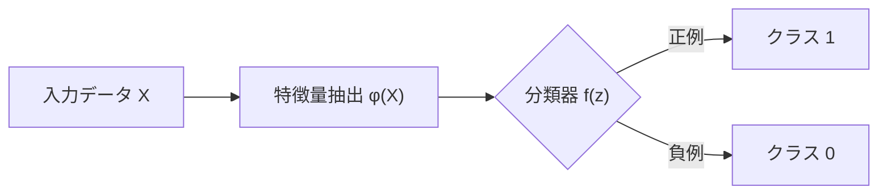

# Lectern ユーザーマニュアル

**Lectern** は、Rust + Tauri で構築された軽量・高速な講義資料作成・変換デスクトップアプリケーションです。  
1つの Markdown ファイルから、印刷・配布向けの **A4 縦ドキュメント（講義レジュメ）** と、投影向けの **16:9 プレゼンテーションスライド** の両方をリアルタイムプレビューしながら執筆し、外部依存のない **100% 自己完結型 HTML / Web スライドショー HTML / 高品質 PDF** として出力できます。

---

## 1. はじめに

### 1.1 Lectern の特徴

- **シングルソース・マルチ出力**：1つの `.md` ファイルを切り替えるだけで「ドキュメント形式（A4縦）」と「スライド形式（16:9）」の両方をプレビュー・出力できます。
- **理工系・学術講義に強い表現力**：KaTeX による高速な数式組版、Mermaid による図表描画、Rust 製 `syntect` によるシンタックスハイライト、コールアウト枠、2カラム組、インタラクティブなタスクリストに対応しています。
- **完全オフライン配布できる自己完結型 HTML**：出力 HTML には KaTeX の CSS・Web フォント（`.woff2`）やローカル画像（Base64 Data URI）がすべて埋め込まれるため、インターネット接続がない環境や LMS（Moodle / Google Classroom 等）へ単一ファイルで配布できます。
- **快適な執筆環境**：行番号・シンタックスハイライト付きの Markdown エディタに加え、検索・置換、スマート改行、行操作、ペア文字囲み、未保存終了警告など実用的なエディタ機能を備えています。

### 1.2 画面構成

Lectern のメインウィンドウは大きく 4 つのエリアで構成されています。

| エリア | 主な内容・操作 |
| --- | --- |
| **上部ツールバー** | 現在のファイル名、保存状態バッジ（`Saved` / `Modified`）、表示モード切替（`📄 ドキュメント` / `🖥️ スライド`）、スライドナビゲーション（スライドモード時のみ）、資料テーマ選択ドロップダウン、ペイン表示切替ボタン（`◧ ファイル` / `👁️ プレビュー`） |
| **クイック挿入バー** | よく使う講義用スニペット（スライド区切り、数式、コードブロック、Mermaid 図表、画像挿入、ポイント/演習枠、2カラム）をカーソル位置へワンクリック挿入 |
| **メイン 3 ペイン** | **左**：ファイル一覧（ファイルエクスプローラー）／ **中央**：Markdown エディタ（検索・置換バー内蔵）／ **右**：リアルタイムプレビュー |
| **下部ステータスバー** | カーソル位置（`行 X, 列 Y`）、総行数・文字数、適用中テーマ（`Theme: ...`）、レンダリング所要時間（`レンダリング: X ms`） |

> [!TIP]
> ファイル操作（新規作成・フォルダを開く・最近開いたフォルダ・保存・各種出力）、編集操作、カスタム CSS 編集、ライト/ダークモード切替、アクティビティログ、アップデート確認、ヘルプは OS 標準の**ネイティブメニューバー**（`ファイル` / `編集` / `表示` / `ヘルプ`）に集約されています。このマニュアルはいつでも **`ヘルプ` → `ユーザーマニュアル...`** から開くことができます。

### 1.3 表示モードの切り替え

ツールバー中央のセグメントボタン、またはメニューの `表示` から 2 つの表示・出力モードを切り替えられます。

- **📄 ドキュメント**（`Cmd+1` / `Ctrl+1`）：A4 縦の講義レジュメ・配布プリント形式でプレビューおよび出力します。
- **🖥️ スライド**（`Cmd+2` / `Ctrl+2`）：16:9 のプレゼンテーションスライド形式でプレビューおよび出力します。
  - スライドモード選択中はツールバーにナビゲーション（`◀` / `1 / N` / `▶`）と **`一覧表示` / `単一表示`** 切替ボタンが表示されます。

### 1.4 ペイン表示切替と幅調整

執筆に集中したいときやプレビューを広く見たいときに、左右のペインを自在に開閉・リサイズできます。

- **ファイル一覧の表示 / 非表示**：ツールバーの `◧ ファイル` ボタン、サイドバー右上の `✕` ボタン、または `Cmd+B` / `Ctrl+B`
- **プレビューの表示 / 非表示**：ツールバーの `👁️ プレビュー` ボタン、または `Cmd+\` / `Ctrl+\`
- **ペイン幅のドラッグ調整**：ペイン間の境界線（リサイザー）を左右にドラッグして幅を変更できます（ファイル一覧：160px 〜 520px、プレビュー：画面幅の 20% 〜 78%）。
- **デフォルト幅へリセット**：境界線を**ダブルクリック**すると、既定の幅（ファイル一覧 240px / プレビュー 48%）に戻ります。
- **キーボードでの幅調整**：境界線にフォーカスを合わせ、`←` / `→` キーで段階的に幅を調整できます。

> [!NOTE]
> ペインの表示/非表示状態と調整した幅は自動的に保存され、次回起動時にもそのまま復元されます。

### 1.5 アプリ UI のライト / ダークモード切替

メニューの `表示` → `ライト / ダークモード切替` から、アプリ全体の UI テーマを切り替えられます。初期状態では OS の外観設定に自動追従し、手動で切り替えた場合はその設定が記憶されます。

---

## 2. ワークスペースとファイルエクスプローラー

### 2.1 フォルダ選択と初回起動時の動作

- メニューの `ファイル` → `フォルダを開く...`（`Cmd+O` / `Ctrl+O`）から、講義資料をまとめたフォルダ（ワークスペース）を選択できます。
- フォルダを開くと、直下にある最初の Markdown ファイルが自動的にエディタへ読み込まれます。
- 初回起動時はサンプル資料フォルダ（パッケージ版単体起動時は `~/Documents/Lectern`）が開かれます。

### 2.2 最近開いたフォルダ履歴（最新 10 件）

- 開いたワークスペースは最新 **10 件** まで自動記録され、`ファイル` → `最近開いたフォルダ` サブメニューからワンクリックで切り替えられます。
- 次回アプリ起動時には、前回最後に開いていたフォルダが自動的に復元されます。フォルダが移動・削除されていた場合は履歴から自動的に取り除かれ、サンプルフォルダへフォールバックします。
- 履歴を整理したい場合は `ファイル` → `最近開いたフォルダ` → `履歴をクリア` を実行してください。

### 2.3 ツリー表示・フィルター検索・階層移動

左ペインのファイル一覧では、ワークスペース配下のフォルダとファイルをコンパクトなツリー構造で閲覧・管理できます。

#### フィルター検索とツールバー操作
ファイルツリー上部のツールバーから、すばやくファイルを絞り込んだり作成・整理したりできます。

- **フィルター検索欄**：キーワードを入力するとファイル・フォルダをリアルタイムに絞り込み、一致部分をハイライト表示します（`✕` でクリア）。
- **新規ファイル / 新規フォルダボタン**：選択中のフォルダ（またはワークスペース直下）にインライン入力欄を開いて、その場でファイルやフォルダを作成できます（`Enter` で確定、`Esc` でキャンセル）。
- **すべて折りたたむ（Collapse All）**：展開しているすべてのサブフォルダを一括で閉じます。

#### 階層移動とキーボード操作

| 操作 | 動作 |
| --- | --- |
| **フォルダをクリック** | その場でサブフォルダを展開 / 折りたたみします。 |
| **フォルダをダブルクリック** または右クリック → ルートとして開く | そのサブフォルダをルートフォルダとしてワークスペース表示を切り替えます。 |
| **先頭の `📁 .. (上の階層へ)`** またはヘッダーの `⬆️` | 1つ上の親ディレクトリへ移動します。 |
| **ヘッダーの `↗`** またはパス表示をクリック | 現在のフォルダ（またはファイル）を Finder / エクスプローラーで開きます（`Cmd+Shift+R` / `Ctrl+Shift+R`）。 |
| **ヘッダーの `↻`** | ファイルツリーを再読み込みして最新の状態に更新します。 |
| **`↑` / `↓` / `←` / `→` / `Enter` / `F2`** | ツリー項目の移動、展開/折りたたみ、ファイルを開く、選択項目のインライン名前変更（`F2`）を行えます。 |

#### 右クリックコンテキストメニュー
ファイル・フォルダ・ツリーの余白を右クリックすると、対象に応じた操作メニューが表示されます。

- **開く**（Markdown ファイルのみ）/ **ルートフォルダとして開く**（フォルダのみ）
- **新規ファイル** / **新規フォルダ**（インライン作成）
- **名前の変更**（`F2` キーでも起動可。ファイルの場合は拡張子を除いたベース名を自動選択）
- **削除**
- **パスをコピー** / **相対パスをコピー**
- **Finder / エクスプローラーで表示**

> [!NOTE]
> 見通しを良くするため、`.` で始まる隠しファイル・フォルダおよび `node_modules` / `target` / `dist` フォルダは一覧から自動的に除外されます。

### 2.4 開けるファイル・開けないファイル

ファイル一覧には Markdown 以外の関連ファイル（画像・PDF・出力済み HTML・CSS 等）もあわせて表示されます。

- **開けるファイル（`.md` / `.markdown`）**：`📝` アイコンと `MD` バッジが表示されます。クリックするとエディタで開きます（別ファイルへ切り替える際、未保存の変更があれば自動保存されます）。右端の `🗑` ボタンから確認ダイアログを経て削除することもできます。
- **開けないファイル（画像・PDF・HTML・CSS・動画・データファイル等）**：拡張子に応じたアイコンとバッジでグレー表示されます。エディタでは開けませんが、右端の `↗` ボタンをクリックすると Finder / エクスプローラーで直接そのファイルを表示できます。

### 2.5 新規ファイル作成と保存

- **新規作成**：`ファイル` → `新規作成...`（`Cmd+N` / `Ctrl+N`）で保存先とファイル名を指定すると、フロントマター・見出し・数式・コードブロックの例を含むテンプレート付き `.md` ファイルが作成され、自動で開きます。
- **保存**：`ファイル` → `保存`（`Cmd+S` / `Ctrl+S`）で上書き保存します。ツールバーのバッジが `Modified` から `Saved` に変わります。

### 2.6 ドラッグ＆ドロップ操作

OS の Finder / エクスプローラーから Lectern のウィンドウへファイルやフォルダを直接ドラッグ＆ドロップできます。

| ドロップ対象 | Lectern の動作 |
| --- | --- |
| **フォルダ** | そのフォルダを新しいワークスペースとして開きます。 |
| **Markdown ファイル** | 親フォルダをワークスペースとして開き、そのファイルをエディタで開きます。 |
| **画像ファイル**（PNG / JPEG / GIF / WebP / SVG / BMP / ICO / AVIF） | エディタのカーソル位置に `` を自動挿入します（同じフォルダ配下なら相対パス、それ以外は絶対パス）。 |

---

## 3. Markdown 執筆ガイド

Lectern は CommonMark / GitHub Flavored Markdown（GFM）をベースに、講義資料・スライド作成のための拡張記法を備えています。

### 3.1 YAML フロントマター

Markdown ファイルの先頭を `---` で囲むと、講義のメタ情報を設定できます。設定した項目はドキュメント先頭のヘッダーやスライド 1 枚目・フッターに自動反映されます。

```yaml
---
course: アルゴリズムとデータ構造
title: 第1回 分割統治法と漸化式
subtitle: 計算量解析の基礎から実装まで
description: マスター定理の基礎とマージソートの実装例を解説します。
author: 情報工学専攻 講義資料
date: 2026-11-17
theme: handout
---
```

| キー名 | 別名 | 役割 |
| --- | --- | --- |
| `course` | `lecture`, `subject` | 科目名（ヘッダー上部のバッジおよびスライドフッターに表示） |
| `title` | — | 講義資料のタイトル（HTML の `<title>` にも反映） |
| `subtitle` | — | サブタイトル（任意） |
| `description` | `summary`, `abstract` | 「資料概要」ボックスとしてヘッダー内に表示 |
| `author` | — | 著者・担当教員名 |
| `date` | — | 講義日・作成日 |
| `theme` | — | 適用するテーマ ID（プレビュー・出力テーマと自動連動） |

### 3.2 スライド区切りとスピーカーノート

コードブロックの外側で、独立した行にハイフン 3 つ `---` を記述すると、**スライドモードではそこで新しいスライドに分割**されます（ドキュメントモードでは水平線として描画されます）。

```markdown
# スライド 1 のタイトル

導入テキストを記述します。

<!-- note: ここでは具体例を板書しながら 3 分程度で説明します。 -->

---

# スライド 2 のタイトル

- ポイント 1
- ポイント 2

<!-- notes:
・時間配分に注意
・次の演習課題への導入を忘れない
-->
```

- 各スライドの下部には、フロントマターの `course` / `title` とスライド番号（例：`2 / 10`）がフッターとして自動表示されます。
- **スピーカーノート**：`<!-- note: ... -->` または `<!-- notes: ... -->`（大文字・小文字区別なし、複数行や 1 スライド内での複数記述にも対応）と書くと、スライド本文からは自動的に非表示になり、Web スライドショー HTML のスピーカーノートドロワー（`N` キー）で発表者メモとして確認できます（コードブロックやインラインコード内の記述はそのまま保持されます）。

### 3.3 見出し・装飾・表・リスト

標準的な Markdown 記法がすべて利用できます。

- **見出し**：`# H1` 〜 `###### H6`
- **文字装飾**：`**太字**`、`*斜体*`、`~~取り消し線~~`、`` `インラインコード` ``
- **リスト**：`- 項目` / `* 項目`（箇条書き）、`1. 項目`（番号付きリスト）
- **引用**：`> 引用テキスト`
- **表（GFM テーブル）**：パイプ `|` とハイフン `-` で記述

```markdown
| アルゴリズム | 最悪計算量 | 安定性 |
| --- | :---: | :---: |
| クイックソート | $O(n^2)$ | 不安定 |
| マージソート | $O(n \log n)$ | 安定 |
```

### 3.4 日本語強調（CJK 強調の自動補正）

通常の CommonMark パーサーでは、日本語の括弧や句読点に隣接する強調記法（例：`これは**「重要な定理」**です` や `旧仕様は~~（廃止済み）~~となりました`）が太字・取り消し線として解釈されないことがあります。

Lectern では日本語（CJK）文字と句読点・括弧の組み合わせを前処理で自動補正しているため、前後に半角スペースを入れなくても自然に太字・取り消し線が適用されます。なお、インラインコード（`` `...` ``）や数式（`$...$`）の内部にある記号には干渉しません。

### 3.5 数式（KaTeX）

LaTeX 形式の数式を KaTeX で高速・高精細にレンダリングします。

- **インライン数式**：`$ ... $` で囲みます。例：`$E = mc^2$`
- **ディスプレイ（ブロック）数式**：`$$ ... $$` で囲みます。

```markdown
$$
\mathcal{L}(\theta) = -\frac{1}{N} \sum_{i=1}^{N} \left[ y_i \log \hat{y}_i + (1 - y_i) \log(1 - \hat{y}_i) \right]
$$
```

> [!TIP]
> クイック挿入バーの `∑ 数式ブロック` または `$ インライン数式` からすぐに雛形を挿入できます。

### 3.6 図表（Mermaid）

言語に `mermaid` を指定したコードブロックを記述すると、フローチャート・シーケンス図・状態遷移図・ER 図などを自動的に SVG として描画します。

````markdown

````

- 構文に誤りがある場合は、プレビュー内の該当箇所に `Mermaid Syntax Error` と詳細が表示されます。
- ノードラベルに括弧 `()` や記号を含める場合は、`A["ラベル (補足)"]` のようにダブルクォートで囲むと安全です。

### 3.7 コードブロックとネスト記法

バッククォート 3 つ（```` ``` ````）の後に言語名（`rust`, `python`, `c`, `javascript`, `bash`, `sql` 等）を指定すると、Rust 側の `syntect` エンジンで高速にシンタックスハイライトされます。ライト系テーマ（`handout`, `academic` 等）では明るい配色、ダーク系テーマ（`chalkboard`, `midnight` 等）では暗い配色が自動選択されます。

#### Markdown 記法の中でコードブロックを例示する（ネスト記法）

講義資料の中で Markdown のコードブロック記法自体を説明したい場合、次のいずれかの方法で安全にネストできます。

1. **4 連バッククォートまたはチルダを使う（CommonMark 標準）**：外側を ```` ````markdown ```` または `~~~markdown` で囲み、内側に ```` ```rust ```` を記述します。
2. **バックスラッシュでエスケープする**：`markdown` / `md` コードブロック内の行頭で `\`\`\`rust`・`\```rust`・`\~~~` のようにエスケープして書くと、プレビューおよび出力時に通常の ```` ```rust ````・`~~~` へ自動復元されます。

> [!NOTE]
> コードブロック内（4 連バッククォートやチルダを含む）に書かれた `---` や `> [!NOTE]` は、スライド区切りやコールアウトとして誤変換されず、コードのまま正確に保持されます。

### 3.8 コールアウト枠

講義の補足・ヒント・重要ポイント・注意喚起を強調するための 4 種類のコールアウト枠に対応しています。

```markdown
> [!NOTE]
> 定義や定理の補足説明を記載します。

> [!TIP]
> 実装のコツや理解を深めるヒントを記載します。

> [!IMPORTANT]
> 演習問題や試験に出る重要ポイントです。

> [!WARNING]
> よくある落とし穴や注意点を記載します。
```

| 記法 | 表示ラベル | 用途の例 |
| --- | --- | --- |
| `> [!NOTE]` | 📘 NOTE / 補足 | 定義・背景知識・参考文献 |
| `> [!TIP]` | 💡 TIP / ヒント | 解法のヒント・便利なテクニック |
| `> [!IMPORTANT]` | 🎓 IMPORTANT / 重要・演習 | 演習課題・重要定理・試験範囲 |
| `> [!WARNING]` | ⚠️ WARNING / 注意 | よくある誤り・実行時の注意点 |

### 3.9 タスクリスト（インタラクティブチェックボックス）

`- [ ]` / `- [x]` で記述したタスクリストは、テーマに合わせたカスタムチェックボックスとして描画されます。

```markdown
- [x] 環境構築を完了する
- [ ] サンプルコードを実行して結果を確認する
- [ ] 演習レポートを提出する
```

プレビュー画面および出力した HTML 上では、チェックボックスを**直接クリックしてオン/オフを切り替えられる**ため、演習手順の確認リストとしてそのまま活用できます。

### 3.10 画像埋め込み（Base64 自動埋め込み・クリップボード貼り付け）

ローカルの画像ファイルを挿入する方法は 4 つあります。

1. クイック挿入バーの **`🖼️ 画像挿入`** ボタンをクリック
2. メニューの `編集` → **`画像を挿入...`**（`Cmd+Shift+I` / `Ctrl+Shift+I`）
3. Finder / エクスプローラーから画像ファイルをウィンドウへ**ドラッグ＆ドロップ**
4. スクリーンショットやクリップボード上の画像をエディタ上でそのまま**貼り付け**（`Cmd+V` / `Ctrl+V`）：編集中の `.md` と同じ階層の `images/` フォルダへ自動保存され、`` がカーソル位置に挿入されます。

挿入される記法は標準の Markdown 画像記法（``）です。HTML の `` タグで直接記述した場合も含め、プレビュー・HTML 出力・PDF 出力時に**ローカル画像が自動的に Base64 Data URI へ変換されて埋め込まれます**。

- **対応フォーマット**：PNG, JPEG (`.jpg`/`.jpeg`), GIF, WebP, SVG, BMP, ICO, AVIF
- **相対パスの基準**：現在編集中の `.md` ファイルが置かれているフォルダ（未保存時はワークスペースのルートフォルダ）

### 3.11 2 カラム組（2 段組レイアウト）

数式とグラフ、理論と具体例などを左右に並べて見せたい場合は、`lecture-columns` クラスを使用します（クイック挿入バーの **`◫ 2カラム`** から雛形を挿入できます）。

```html
<div class="lecture-columns">
<div>

### 左カラム：理論・定義
- 線形変換 $T: V \to W$
- 核 $\ker(T)$ と像 $\mathrm{Im}(T)$

</div>
<div>

### 右カラム：具体例・応用
- 次元定理: $\dim V = \dim \ker(T) + \dim \mathrm{Im}(T)$
- 主成分分析 (PCA) への応用

</div>
</div>
```

> [!TIP]
> `<div>` タグと中の Markdown 記述の間には**空行を 1 行入れる**と、見出しやリスト・数式が正しく Markdown として解釈されます。

### 3.12 印刷・PDF 用の明示的改ページ

ドキュメント形式で任意の箇所に改ページを挿入したい場合は、コードブロックの外側に以下のコメント行を記述します。

```markdown
<!-- pagebreak -->
```

（`<!-- page-break -->` にも対応しています。大文字・小文字は区別されません。）プレビューおよび画面表示では控えめな破線の「ページ区切り」として表示され、印刷・PDF 出力時にはその位置で確実に改ページされます。

---

## 4. エディタ機能＆ショートカット一覧

Lectern のエディタは、すべての編集操作（置換・行操作・インデント・クイック挿入を含む）が OS 標準の Undo / Redo 履歴と統合されており、いつでも安全に操作を取り消せます。

### 4.1 検索・置換バー

- **`Cmd+F` / `Ctrl+F`** で検索バーを開き、**`Cmd+H` / `Ctrl+H`**（または `Cmd+Alt+F` / `Ctrl+Alt+F`）で置換欄も開いた状態で起動します。
- エディタ上で単一行のテキストを選択した状態で開くと、その文字列が検索欄に自動入力されます。
- 検索欄では **`Enter`** で次の一致、**`Shift+Enter`** で前の一致へジャンプします（日本語 IME の変換確定 `Enter` には反応しない IME セーフ設計です）。
- オプションボタン：
  - **`Aa`**：大文字・小文字を区別
  - **`.*`**：正規表現を使用（構文エラー時は「正規表現エラー」と表示）
  - **`⇄`**：置換欄の表示 / 非表示を切替
  - **`置換` / `すべて置換`**：現在の一致または文書全体を一括置換（`Cmd+Z` / `Ctrl+Z` で一括取り消し可能）
  - **`Esc`** または `✕`：検索バーを閉じてエディタへフォーカスを戻す

### 4.2 スマート改行とインデント

- **Tab / Shift+Tab**：
  - 単一カーソル位置での `Tab` は半角スペース 2 つを挿入します。
  - 複数行を選択して `Tab` を押すと、選択したすべての行を一括インデントします。
  - `Shift+Tab` は単一行・複数行のいずれでも先頭のインデント（タブまたはスペース最大 2 つ）を一括解除します。
- **スマート改行（IME セーフ）**：
  - 箇条書き（`- `, `* `, `+ `）、番号付きリスト（`1. ` → 次行は自動で `2. ` に連番）、タスクリスト（`- [ ] ` / `- [x] ` → 次行は `- [ ] `）、引用（`> `）、インデント行で `Enter` を押すと、記号やインデントを自動継続します。
  - テキストが空のリスト記号・引用記号の行で `Enter` を押すと、記号をきれいに消去して通常の行に戻ります。

### 4.3 行操作・ペア文字囲み・指定行移動・見出しアウトライン

- **行の複製**（`Cmd+Shift+D` / `Ctrl+Shift+D`）：カーソル行または選択中の複数行を直下に複製します。
- **行の削除**（`Cmd+Shift+K` / `Ctrl+Shift+K`）：カーソル行または選択中の複数行を削除します。
- **行の上下移動**（`Alt+↑` / `Alt+↓`）：カーソル行または選択中の複数行を 1 行上・下へ移動します。
- **ペア文字囲み**：テキストを選択した状態で以下の開き記号を入力すると、選択テキストを上書きせずペアで囲みます。
  - 対応記号：`` ` ``、`*`、`_`、`~`、`"`、`'`、`(` → `)`、`[` → `]`、`{` → `}`、`「` → `」`、`（` → `）`、`$`
- **指定行へ移動**（`Cmd+G` / `Ctrl+G`）：行番号を入力して該当行へジャンプします。
- **見出しアウトラインへ移動**（`Cmd+Shift+O` / `Ctrl+Shift+O`）：文書内の H1〜H3 見出し一覧からキーワード絞り込みで目的のセクションへ素早くジャンプします。
- **エディタ・プレビュー同期**：エディタのスクロール位置（ドキュメント形式）やカーソル位置（スライド形式）に合わせてプレビューが自動追従します（環境設定でオン/オフ切替可能）。

### 4.4 環境設定（Preferences）と自動保存

メニューの `Lectern` / `表示` → **`環境設定...`**（`Cmd+,` / `Ctrl+,`）から、エディタの表示・動作をリアルタイムにカスタマイズできます（設定は自動保存されます）。

- **フォントサイズ**（11px〜22px）・**行間**（1.30〜2.20）・**タブ幅**（2 / 4 スペース）・**右端で折り返す（Word Wrap）**
- **自動保存（Auto Save）**：オンにすると、入力停止後（0.5秒〜5秒の指定時間後）に開いているファイルを自動的に上書き保存します。
- **プレビューとスクロール同期**：エディタとプレビューのスクロール / スライド連動のオン・オフを切り替えます。

### 4.5 未保存終了警告

編集中のファイルに未保存の変更（ステータスが `Modified`）がある状態でウィンドウを閉じようとすると、確認ダイアログが表示されます。

- **保存して終了**：変更を保存してからアプリを終了します。
- **保存せずに終了**：変更を破棄して終了します。
- **キャンセル**：終了を中止して編集画面へ戻ります。

### 4.6 キーボードショートカット一覧

#### ファイル操作

| 機能 | macOS | Windows / Linux |
| --- | --- | --- |
| 新規ファイル作成 | `Cmd+N` | `Ctrl+N` |
| フォルダを開く | `Cmd+O` | `Ctrl+O` |
| 上書き保存 | `Cmd+S` | `Ctrl+S` |
| HTML として出力 | `Cmd+Shift+E` | `Ctrl+Shift+E` |
| スライドショー HTML として出力 | `Cmd+Shift+S` | `Ctrl+Shift+S` |
| PDF として出力 | `Cmd+Shift+P` | `Ctrl+Shift+P` |
| Finder / エクスプローラーで表示 | `Cmd+Shift+R` | `Ctrl+Shift+R` |

#### 編集操作

| 機能 | macOS | Windows / Linux |
| --- | --- | --- |
| 元に戻す (Undo) | `Cmd+Z` | `Ctrl+Z` |
| やり直す (Redo) | `Cmd+Shift+Z` | `Ctrl+Y` / `Ctrl+Shift+Z` |
| 検索 | `Cmd+F` | `Ctrl+F` |
| 置換 | `Cmd+H` / `Cmd+Alt+F` | `Ctrl+H` / `Ctrl+Alt+F` |
| 指定行へ移動 | `Cmd+G` | `Ctrl+G` |
| 見出しアウトラインへ移動 | `Cmd+Shift+O` | `Ctrl+Shift+O` |
| 行を複製 | `Cmd+Shift+D` | `Ctrl+Shift+D` |
| 行を削除 | `Cmd+Shift+K` | `Ctrl+Shift+K` |
| 行を上下に移動 | `Option+↑` / `Option+↓` | `Alt+↑` / `Alt+↓` |
| インデント / アウトデント | `Tab` / `Shift+Tab` | `Tab` / `Shift+Tab` |
| 画像を挿入 | `Cmd+Shift+I` | `Ctrl+Shift+I` |

#### 表示・ペイン操作

| 機能 | macOS | Windows / Linux |
| --- | --- | --- |
| ドキュメント形式 (A4縦) | `Cmd+1` | `Ctrl+1` |
| スライド形式 (16:9) | `Cmd+2` | `Ctrl+2` |
| ファイル一覧の表示 / 非表示 | `Cmd+B` | `Ctrl+B` |
| プレビューの表示 / 非表示 | `Cmd+\` | `Ctrl+\` |
| 環境設定を開く | `Cmd+,` | `Ctrl+,` |
| アクティビティログを表示 | `Cmd+Shift+L` | `Ctrl+Shift+L` |

---

## 5. テーマ切替とカスタム CSS 編集

### 5.1 内蔵されている 5 つのテーマ

ツールバー右上のドロップダウン、またはフロントマターの `theme:` でいつでも切り替えられます。テーマを切り替えると、プレビュー・HTML 出力・スライドショー出力・PDF 出力のすべてに共通適用されます。

| テーマ ID | 表示名 | 特徴・おすすめ用途 |
| --- | --- | --- |
| `handout` | **Handout (講義レジュメ・明朝)** | 角ゴシック見出し＋明朝体本文、白地ベースでゆったり読める標準テーマ。配布レジュメや印刷資料に最適。 |
| `default` | **Modern (モダン・サンセリフ)** | クリーンなサンセリフ体と爽やかなアクセントカラーの標準モダンデザイン。 |
| `academic` | **Academic (論文・モノグラフ)** | 学術論文や技術モノグラフ風の端正な組版。数式中心の講義や定理証明に最適。 |
| `chalkboard` | **Chalkboard (黒板・チョーク)** | 黒板風の背景にチョーク調の配色。板書イメージのスライド講義に最適。 |
| `midnight` | **Midnight (ダーク・プロジェクター)** | 暗い教室でのプロジェクター投影でも眩しくない高コントラスト・ダークテーマ。 |

> [!TIP]
> ドロップダウンからテーマを変更すると、Markdown 先頭のフロントマターに既に `theme:` 行がある場合は自動的に新しいテーマ ID へ書き換え同期されます。

### 5.2 カスタム CSS テーマの作成と保存

メニューの `表示` → **`カスタム CSS テーマを編集...`** を開くと、独自のテーマ CSS を編集・保存できます。

1. 現在のテーマ CSS がエディタに読み込まれます。`.lecture-render-root` や `.lecture-slide` などを対象にスタイルを編集します。
2. 保存する**テーマ ID**（例：`my-university`）を入力します。
3. 必要に応じて「現在の Markdown 先頭 (`theme: ...`) にも書き込む」にチェックを入れます。
4. 適用方法を選びます：
   - **`一時適用のみ`**：ファイルは作成せず、現在のプレビューと出力にだけ一時的に反映します。
   - **`💾 themesフォルダに保存して適用`**：ワークスペース直下の `themes/<テーマID>.css` として保存し、テーマ一覧ドロップダウンに `✨ Custom: <テーマID>.css` として追加します。

> [!NOTE]
> ワークスペースを開くだけで勝手に `themes/` フォルダが作成されることはありません。また、`themes/handout.css` のように内蔵テーマと同名のファイルが存在する場合でも、アプリ内蔵の最新定義を上書きせず `local-handout` として別途選択できる安全な仕様になっています。

---

## 6. 出力機能

出力時に未保存の変更がある場合は自動的に保存した上で、OS 標準の保存ダイアログが開きます。出力完了後は完了ダイアログの **`📂 保存先をFinder / エクスプローラーで開く`** からすぐに確認できます。

### 6.1 ドキュメント / スライド HTML 出力

- **操作**：`ファイル` → `HTML として出力...`（`Cmd+Shift+E` / `Ctrl+Shift+E`）
- 現在の表示モード（ドキュメント A4 縦 / スライド 16:9）と選択中のテーマで、**100% 自己完結型の単一 HTML ファイル**を出力します。
- KaTeX のスタイル・フォント、シンタックスハイライト、Mermaid SVG、ローカル画像（Base64）がすべて 1 ファイル内に収まるため、そのまま配布・ブラウザ閲覧・印刷ができます。
- **自動目次（ToC）ドロワー**（ドキュメント形式）：H1〜H3 見出しが 2 つ以上ある場合、画面右上の **`☰ 目次`** ボタン（または `M` キー、`Esc` で閉じる）から折りたたみ式の目次を開いて各セクションへスムーズに移動できます（印刷時は自動で非表示になります）。
- スライドモードで出力した HTML でも、ブラウザ上で `←` / `→` / `PageUp` / `PageDown` キーによるスライド間のスムーズ移動に対応しています。

### 6.2 Web スライドショー HTML 出力と操作キー

- **操作**：`ファイル` → `スライドショー HTML として出力...`（`Cmd+Shift+S` / `Ctrl+Shift+S`）
- ドキュメント表示中から実行した場合も自動的にスライド形式でレンダリングし、Web ブラウザ上でそのままプレゼンテーションできる **全画面・16:9 自動スケーリング対応スライドショー HTML** を出力します。
- ブラウザのウィンドウサイズに合わせて自動拡大縮小され、以下のプレゼン支援機能を備えています（すべて 100% オフライン動作・印刷時は自動的に非表示になります）：
  - **自動非表示のフローティング操作 HUD**（前へ / スライド番号カウンター / 次へ / 一覧 / ノート / 🎙 発表者 / 全画面 / ヘルプ）と下部プログレスバー
  - **2 ウィンドウ同期・発表者ビュー（`P` キー / `🎙 発表者` ボタン）**：プロジェクター投影用のメイン画面と同期する別ウィンドウの発表者ダッシュボードを開きます。現在のスライド・次のスライドプレビュー・スピーカーノート・経過時間タイマー（開始/一時停止/リセット）・現在時刻を確認しながら、どちらのウィンドウからでもスライド送りが同期されます（100% オフライン動作）
  - **画面左右端のホバーナビゲーションボタン**：スライドのテキスト選択やリンク・チェックボックス操作を邪魔せず、画面端にカーソルを合わせるだけで前後のスライドへ移動可能
  - **スピーカーノートドロワー（`N` キー）**：`<!-- note: ... -->` で記述した発表者メモをスライドごとに確認可能（ノートがあるスライドは HUD 上にインジケーター表示）
  - **スライド目次（TOC）ジャンプメニュー（`T` キー / カウンタークリック）**：全スライドのタイトル一覧からワンクリックで任意のページへ移動
  - **スライド一覧グリッド（`O` / `G` キー）**：各スライドのタイトルプレビューとノートバッジ（`🗒`）付きのサムネイル一覧
  - **ショートカットヘルプオーバーレイ（`?` キー）**：発表中でもすぐ操作キーを確認可能
  - **URL ハッシュ（例：`#3`）** でのページ指定や、ブラウザの印刷機能、OS の「視差効果を減らす（`prefers-reduced-motion`）」設定にも対応

#### Web スライドショーの操作キー一覧

| 操作 | キーボード / ジェスチャー |
| --- | --- |
| 次のスライドへ | `→` / `↓` / `PageDown` / `Space` / `Enter`（タッチ端末：左スワイプ、または画面右端クリック） |
| 前のスライドへ | `←` / `↑` / `PageUp` / `Backspace`（タッチ端末：右スワイプ、または画面左端クリック） |
| 最初のスライドへ | `Home` |
| 最後のスライドへ | `End` |
| スライド一覧グリッド（オーバービュー）切替 | `O` / `G`（一覧上でクリックして移動、`Esc` で閉じる） |
| スライド目次（TOC）ジャンプメニュー切替 | `T`（または下部 HUD のスライド番号カウンターをクリック） |
| スピーカーノートドロワー表示 / 非表示 | `N` |
| 発表者ビュー（別ウィンドウ同期）を開く | `P`（または HUD の `🎙 発表者` ボタン） |
| 全画面表示の切替 | `F` |
| ショートカットヘルプ表示 | `?`（`Esc` で閉じる） |

### 6.3 PDF 出力

- **操作**：`ファイル` → `PDF として出力...`（`Cmd+Shift+P` / `Ctrl+Shift+P`）
- 現在の表示モード（ドキュメント：A4 縦、スライド：16:9 ワイドページ）とテーマで、高品質な PDF ファイルを生成します。
- 内部ではシステムにインストールされている Chromium 系ブラウザ（**Google Chrome / Microsoft Edge / Brave Browser / Chromium**）のヘッドレス印刷エンジンを自動検出して利用します。
- 対象ブラウザが見つからない場合は、自動的にアプリの印刷ダイアログへフォールバックします。

### 6.4 CLI（コマンドライン）からの一括変換

Lectern は GUI だけでなくコマンドラインからも Markdown → HTML / PDF 変換を実行できます。Makefile やシェルスクリプトと組み合わせて、複数回の講義資料を一括ビルドする用途に便利です。

#### 基本書式

```bash
cargo run -- --cli <入力.md> [--mode document|slide] [--theme <テーマID または .cssパス>] [--output <出力.html|出力.pdf>]
```

| オプション | 短縮形 | 説明 |
| --- | --- | --- |
| `--mode` | `-m` | `document`（既定）または `slide` |
| `--theme` | `-t` | 内蔵テーマ ID（`handout`, `academic` 等）、ワークスペースのカスタムテーマ ID、または任意の `.css` ファイルパス。省略時はフロントマターの `theme:` または `handout` を使用 |
| `--output` | `-o` | 出力ファイルパス。拡張子が `.pdf` の場合は PDF 出力、それ以外は HTML 出力（省略時は入力ファイルと同名の `.html`） |

#### 実行例

```bash
# スライド形式・academic テーマで PDF を出力
cargo run -- --cli sample-lectures/01_intro.md --mode slide --theme academic --output dist/01_intro.pdf

# 複数ファイルを一括でドキュメント HTML へ変換（bash / zsh）
for f in lectures/*.md; do
  cargo run -- --cli "$f" -m document -t handout -o "out/$(basename "$f" .md).html"
done
```

---

## 7. セルフアップデートとトラブルシューティング

### 7.1 セルフアップデート

Lectern は GitHub Releases（`Nagatani/lectern`）を通じたアプリ内セルフアップデートに対応しています。

- **自動確認**：アプリ起動から約 4 秒後にバックグラウンドで静かに最新バージョンを確認します（オフライン環境ではエラーを出さずにスキップします）。
- **手動確認**：メニューの `ヘルプ` → **`アップデートを確認...`**（macOS では `Lectern` メニュー内にもあります）からいつでも確認できます。
- **適用手順**：新バージョンが見つかった場合、リリースノート付きの確認ダイアログが表示されます。**`今すぐアップデートして再起動`** をクリックすると、編集中に未保存の変更があれば自動保存した上でダウンロード・インストール・再起動を行います。

> [!NOTE]
> **開発者向け（リリース手順）**：リポジトリ同梱のスクリプト `npm run release -- patch`（または `minor` / `major` / `X.Y.Z`）を実行すると、各設定ファイルのバージョン一括更新・リリースコミット・タグ作成・push まで自動化し、GitHub Actions 経由でセルフアップデート用アセットを公開できます（`--dry-run` / `--no-push` オプションにも対応）。

### 7.2 アクティビティログの確認方法

操作の成否やエラー詳細を確認したいときは、メニューの `表示` → **`アクティビティログを表示...`**（`Cmd+Shift+L` / `Ctrl+Shift+L`）を開きます。

- ファイルの読み込み・保存・HTML / PDF 出力・テーマ適用・エラーなどの履歴が時刻付きで最新 **200 件** まで記録されます。
- **`ログをクリア`** ボタンで表示中のログを消去できます。

### 7.3 よくあるトラブルと対処法

#### PDF 出力時にブラウザが見つからないエラーが出る
- Lectern のヘッドレス PDF 出力は Google Chrome / Microsoft Edge / Brave / Chromium のいずれかを使用します。
- いずれもインストールされていない環境では、エラー発生後に自動的に印刷ダイアログが開くため、OS の「PDF として保存」機能をご利用ください。

#### ローカル画像がプレビューや出力 HTML に表示されない
- 相対パスの基準は**現在編集中の `.md` ファイルがあるディレクトリ**です（例：`images/fig1.png` は `.md` と同じ階層にある `images` フォルダを参照します）。
- ファイル名の大文字・小文字や拡張子が正確か確認してください。迷った場合は画像ファイルをウィンドウへドラッグ＆ドロップすると正確なパスが自動挿入されます。

#### Mermaid 図表が描画されずエラーになる
- プレビュー上に表示される `Mermaid Syntax Error` のメッセージを確認してください。
- 日本語や括弧 `()`・コロン `:` を含むノードラベルは、`A["処理 (例)"]` のようにダブルクォートで囲むことで構文エラーを防げます。

#### アップデート確認が失敗する
- インターネット接続がないオフライン環境では確認に失敗します。
- また、ソースコードからローカルビルドした開発版で署名公開鍵（`pubkey`）や公開リリースが未設定の場合も確認エラーとなります。詳細はアクティビティログで確認できます。
