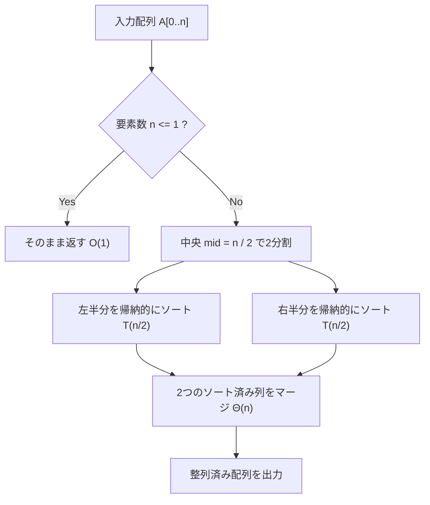

# 第1回：分割統治法と漸化式の解析

本講義では、**分割統治法 (Divide and Conquer)** の設計原理と、アルゴリズムの時間計算量を厳密に導出する**マスター定理 (Master Theorem)** について学びます。

> [!NOTE]
> **本日の到達目標**:
> 1. 再帰アルゴリズムの時間計算量を漸化式 $T(n)$ として定式化できる
> 2. 二分探索およびマージソートの実装と計算量を説明できる
> 3. フローチャートを用いて処理フローを可視化できる

## 1. マスター定理による漸化式の解法

サイズ $n$ の問題を、サイズ $n/b$ の $a$ 個の部分問題に分割し、分割・統合に $f(n)$ の時間を要する場合、時間計算量 $T(n)$ は次の漸化式で表されます。

$$
T(n) = a \, T\!\left(\frac{n}{b}\right) + f(n) \quad (a \ge 1, \; b > 1)
$$

ここで、臨界指数を $c_{\mathrm{crit}} = \log_b a$ と定義すると、漸近的挙動は以下の3ケースに分類されます：

| ケース | 条件 | 漸近計算量 $\Theta(\cdot)$ | 代表的なアルゴリズム |
| :--- | :--- | :--- | :--- |
| **Case 1** | $f(n) = O(n^{c_{\mathrm{crit}} - \varepsilon})$ | $\Theta(n^{\log_b a})$ | Strassenの行列積 ($O(n^{\log_2 7})$) |
| **Case 2** | $f(n) = \Theta(n^{c_{\mathrm{crit}}} \log^k n)$ | $\Theta(n^{\log_b a} \log^{k+1} n)$ | マージソート ($\Theta(n \log n)$) |
| **Case 3** | $f(n) = \Omega(n^{c_{\mathrm{crit}} + \varepsilon})$ | $\Theta(f(n))$ | クイックセレクト期待値 ($\Theta(n)$) |

---

# 2. 分割統治法の処理フロー (Mermaid図表と画像の埋め込み)

マージソート (Merge Sort) における分割 (Divide)・統治 (Conquer)・結合 (Combine) の流れは以下の通りです。




---

# 3. Rust によるマージソートと二分探索の実装

Rust のスライスとジェネリクス (`T: Ord + Copy`) を用いた安全な実装例を示します。

```rust
/// ソート済みスライスに対する二分探索: 時間計算量 O(log n)
pub fn binary_search<T: Ord>(arr: &[T], target: &T) -> Option<usize> {
    let mut low = 0usize;
    let mut high = arr.len();

    while low < high {
        let mid = low + (high - low) / 2;
        match arr[mid].cmp(target) {
            std::cmp::Ordering::Equal => return Some(mid),
            std::cmp::Ordering::Less => low = mid + 1,
            std::cmp::Ordering::Greater => high = mid,
        }
    }
    None
}

/// マージ操作: 2つの整列済みスライスを結合する Θ(n)
pub fn merge<T: Ord + Copy>(left: &[T], right: &[T]) -> Vec<T> {
    let mut result = Vec::with_capacity(left.len() + right.len());
    let (mut i, mut j) = (0, 0);
    while i < left.len() && j < right.len() {
        if left[i] <= right[j] {
            result.push(left[i]);
            i += 1;
        } else {
            result.push(right[j]);
            j += 1;
        }
    }
    result.extend_from_slice(&left[i..]);
    result.extend_from_slice(&right[j..]);
    result
}
```

---

# 4. 演習問題・レポート課題

<div class="lecture-columns">
<div>

### 理論問題
以下の漸化式の漸近的計算量を $\Theta$ 記法で求めよ。
1. $T(n) = 4T(n/2) + n^2$
2. $T(n) = 2T(n/2) + n \log n$
3. $T(n) = 3T(n/4) + n \log n$

</div>
<div>

### 実装課題
`binary_search` 関数を拡張し、重複要素が存在する場合に**最小のインデックス (lower_bound)** を返す関数を Rust で実装せよ。

</div>
</div>

> [!IMPORTANT]
> **提出期限**: 次回講義開始前までに PDF または HTML 形式で提出してください。
