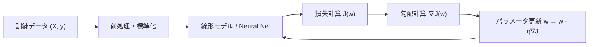

# 第2回：勾配降下法と正則化理論

本資料では、経験リスク最小化 (ERM) における**確率的勾配降下法 (SGD)** の収束性と、L2正則化（リッジ回帰）のベイズ的解釈を解説します。

## 1. 目的関数とL2正則化

訓練データ集合 $\mathcal{D} = \{(\mathbf{x}_i, y_i)\}_{i=1}^{N}$ に対し、パラメータ $\mathbf{w} \in \mathbb{R}^d$ の目的関数 $J(\mathbf{w})$ を次のように定義します。

$$
J(\mathbf{w}) = \frac{1}{2N} \sum_{i=1}^{N} \left( \mathbf{w}^\top \mathbf{x}_i - y_i \right)^2 + \frac{\lambda}{2} \|\mathbf{w}\|_2^2
$$

勾配 $\nabla_{\mathbf{w}} J(\mathbf{w})$ を $0$ とおくことで、閉形式解（正規方程式）が得られます：

$$
\hat{\mathbf{w}}_{\mathrm{Ridge}} = \left( \mathbf{X}^\top \mathbf{X} + N\lambda \mathbf{I}_d \right)^{-1} \mathbf{X}^\top \mathbf{y}
$$

---

# 2. 学習パイプラインのアーキテクチャ



---

# 3. Python による勾配降下法の実装

```python
import numpy as np

def ridge_gradient_descent(
    X: np.ndarray,
    y: np.ndarray,
    lr: float = 0.05,
    lam: float = 1e-2,
    epochs: int = 200,
) -> np.ndarray:
    n_samples, n_features = X.shape
    w = np.zeros(n_features, dtype=np.float64)

    for _ in range(epochs):
        residual = X @ w - y
        grad = (X.T @ residual) / n_samples + lam * w
        w -= lr * grad

    return w
```

> [!TIP]
> 固有値の最大値を $\sigma_{\max}$ とすると、学習率 $\eta$ が $0 < \eta < \frac{2}{\sigma_{\max} + \lambda}$ を満たすとき大域的収束が保証されます。
