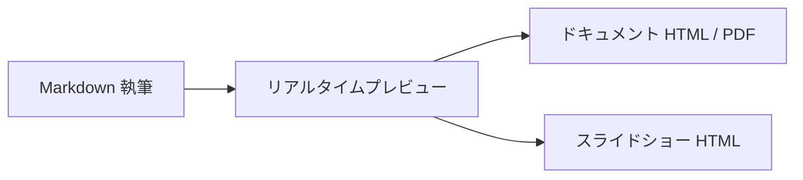

# 1. Frontmatter（フロントマター）の設定と説明

Markdown ファイルの先頭を `---` で囲んだ **YAML Frontmatter** を記述すると、講義資料のヘッダー情報・テーマ・HTML 出力時の挙動を一括で設定できます。

````yaml
---
course: 情報科学演習
title: 講義資料サンプルと Frontmatter 設定ガイド
subtitle: ドキュメント出力・自動目次・改ページ・コールアウトの実践テンプレート
description: 講義の概要や到達目標を記載します。
author: 情報科学科 担当教員
date: 2026-11-27
theme: handout
toc: true
lang: ja
---
````

## 1.1 指定できる設定項目一覧

| キー名 | 必須 | 既定値 | 役割と出力先 |
| :--- | :---: | :--- | :--- |
| `course` | 任意 | なし | 講義名・科目名。ヘッダー上部にバッジ表示されます（別名：`lecture`, `subject`） |
| `title` | 推奨 | ファイル名等 | 資料のメインタイトル。ヘッダーの `<h1>` および出力 HTML の `<title>` に反映されます |
| `subtitle` | 任意 | なし | タイトル直下に表示されるサブタイトル |
| `description` | 任意 | なし | 講義の概要・アブストラクト枠としてヘッダー下部に表示されます（別名：`summary`, `abstract`） |
| `author` | 任意 | なし | 担当教員名・著者名 |
| `date` | 任意 | なし | 講義日・作成日（例：`2026-11-27`） |
| `theme` | 任意 | `handout` | 適用テーマ ID（`handout` / `default` / `academic` / `chalkboard` / `midnight` または `themes/*.css` のファイル名） |
| `toc` | 任意 | `false` | ドキュメント HTML 出力時に右上の折りたたみ式「目次（`☰ 目次`）」を付けるか（`true` / `false`） |
| `lang` | 任意 | `ja` | 出力 HTML の `<html lang="...">` 属性。英語資料では `en` を指定します（別名：`language`） |

> [!TIP]
> ツールバーのテーマ選択ドロップダウンからテーマを切り替えると、Frontmatter 内の `theme:` 行も自動的に同期更新されます。

> [!NOTE]
> `toc: true` を設定すると、ドキュメント HTML 出力時に選択中テーマの配色・フォントに調和した自動目次（`M` キーで開閉）が有効になります。印刷（PDF）時は自動で非表示になります。

---

# 2. 講義資料でよく使う表現パーツ

## 2.1 コールアウト枠（補足・ヒント・重要・注意）

> [!NOTE]
> **補足（NOTE）**: 定義・背景知識・参考文献の案内などに使用します。

> [!TIP]
> **ヒント（TIP）**: 演習を解くコツやショートカットの補足に使用します。

> [!IMPORTANT]
> **重要・演習（IMPORTANT）**: 試験に出るポイントやレポート課題の指示を強調できます。

> [!WARNING]
> **注意（WARNING）**: よくある誤答例や環境構築時の注意点を目立たせます。

## 2.2 数式（KaTeX）とコードブロック

インライン数式は `$E = mc^2$` のように記述し、ディスプレイ数式は `$$ ... $$` で囲みます。文章中のコードは `std::vec::Vec` や `npm run build` のようにバッククォートで囲めます。

$$
\mathrm{softmax}(z_i) = \frac{e^{z_i}}{\sum_{j=1}^{K} e^{z_j}} \quad (i = 1, \dots, K)
$$

```python
import math

def softmax(logits: list[float]) -> list[float]:
    max_val = max(logits)
    exps = [math.exp(x - max_val) for x in logits]
    total = sum(exps)
    return [v / total for v in exps]
```

<!-- pagebreak -->

# 3. 改ページ・図表・アクセシビリティ配慮

直前の `<!-- pagebreak -->` により、印刷・PDF 出力時にはここから新しいページが開始されます（画面プレビュー上では破線の区切りとして表示されます）。

## 3.1 2 カラムレイアウト

<div class="lecture-columns">
<div>

### 長所（メリット）
- 1 つの `.md` からドキュメントとスライドを兼用できる
- オフライン完結の HTML として LMS へそのまま配布できる
- 数式・図表・画像が単一ファイルに埋め込まれる

</div>
<div>

### 活用のコツ
- 配布資料には `theme: handout` や `academic` が読みやすい
- 長文レジュメには `toc: true` を付けると閲覧しやすい
- 英語フレーズは `<span lang="en">Machine Learning</span>` と書くと読み上げが自然になる

</div>
</div>

## 3.2 Mermaid 図表とアクセシビリティタイトル

Mermaid コードブロック内に `accTitle:` を 1 行書くと、HTML 出力時の `<figure aria-label="...">` に自動で設定され、スクリーンリーダー利用者に図の目的が伝わります。



## 3.3 受講前チェックリスト

HTML 出力後もブラウザ上で直接チェックを入れられます。

- [x] Frontmatter に `course` / `title` / `theme` を設定した
- [x] 見出しレベル（`#` → `##` → `###`）を順番に使った
- [ ] 画像や Mermaid 図表に説明（`alt` / `accTitle:`）を付けた
- [ ] HTML または PDF で出力して仕上がりを確認した
