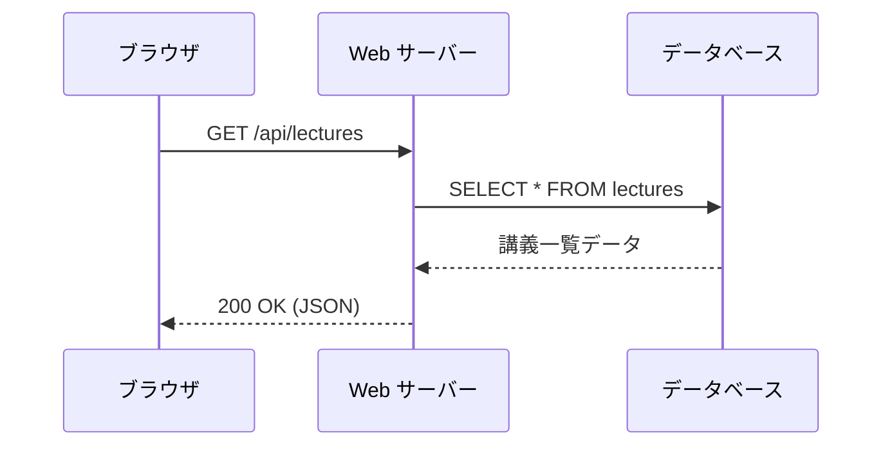

# 本日のアジェンダ

スライドモード（`Cmd+2` / `Ctrl+2`）または **スライドショー HTML 出力**（`Cmd+Shift+S` / `Ctrl+Shift+S`）で表示すると、16:9 のプレゼンテーションとして再生できます。

- **独立した `---` 行** がスライドの区切りになります
- **`<!-- note: ... -->`** に書いたメモは投影画面には出ず、発表者ビュー（`P` キー）に表示されます
- テーマは `midnight` / `chalkboard` / `default` / `handout` / `academic` を自由に切り替えられます

<!-- note: 導入スライドです。約1分で本日の流れを説明します。スライドショー出力後は P キーで発表者ビューを開けます。 -->

---

# 2 カラムで比較・対比を整理する

<div class="lecture-columns">
<div>

## 講義レジュメ（Document）
- A4 縦・印刷配布向け
- 詳しい文章解説・補足コラム
- `toc: true` で折りたたみ目次を表示
- `<!-- pagebreak -->` で任意の改ページ

</div>
<div>

## プレゼン（Slide）
- 16:9 ワイド画面・投影向け
- 箇条書き・図表・数式を中心に構成
- `<!-- note: ... -->` でスピーカーノート管理
- `G` 一覧・`T` 目次・`F` 全画面・`P` 発表者ビュー

</div>
</div>

<!-- note: 1つの Markdown から両方作れる強みを強調します。投影時は文章を詰め込みすぎないのがポイントです。 -->

---

# 処理フローの可視化（Mermaid 図表）

図表コードに `accTitle:` を付けておくと、アクセシビリティ対応のラベルも自動出力されます。



<!-- note: シーケンス図を使い、クライアント・サーバー・DB の3者の役割分担を順番に指し示しながら説明します。 -->

---

# 数式と実装コードを並べて解説する

最小二乗法の目的関数：

$$
J(\mathbf{w}) = \frac{1}{2N} \sum_{i=1}^{N} \left( \hat{y}_i - y_i \right)^2
$$

```rust
/// 平均二乗誤差 (MSE) を計算する
pub fn mean_squared_error(preds: &[f64], targets: &[f64]) -> f64 {
    let sum: f64 = preds
        .iter()
        .zip(targets.iter())
        .map(|(p, t)| (p - t).powi(2))
        .sum();
    sum / (2.0 * preds.len() as f64)
}
```

<!-- note: 数式の 1/2N の係数と、Rust コード内の 2.0 * preds.len() が対応している点を解説します。 -->

---

# 演習タイム（5 分）

> [!IMPORTANT]
> **グループディスカッション課題**
> 1. 自分の担当講義で最も図解したい概念を 1 つ選ぶ
> 2. Mermaid のフローチャートまたはシーケンス図で 5 ノード以内に整理する
> 3. `<!-- note: ... -->` に口頭で補足したい具体例を書き添える

- [ ] テーマを決めた
- [ ] 図表またはコードブロックを 1 つ配置した
- [ ] スライドショー HTML を出力し、`P` キーで発表者ビューを確認した

<!-- note: ここでタイマーを 5 分計ります。発表者ビュー右上のタイマー開始ボタンを使うと便利です。 -->

---

# スライドショー操作ショートカットまとめ

| 操作 | キー |
| :--- | :--- |
| 次へ / 前へ | `→` / `←` / `Space` / `PageDown` / `PageUp` |
| 発表者ビュー（2 画面同期・タイマー） | `P` |
| スピーカーノート表示 | `N` |
| スライド一覧（オーバービュー） | `G` / `O` |
| スライド目次ジャンプ | `T` |
| 全画面切替 / ヘルプ表示 | `F` / `?` |

<!-- note: 質疑応答に入ります。スライドショー HTML は完全オフラインで動くため、講義室の PC にコピーするだけで発表できます。 -->
