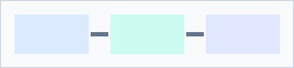

# 1. 日本語テキストの強調とインラインコード

Lectern は日本語の括弧や句読点に隣接する強調記法も正しく変換します。

- これは**「重要」**な用語で、`println!` や `Option<T>` のようにインラインコードを混ぜても綺麗に並びます。
- 取り消し線は ~~旧仕様~~ のように記述します。
- 英語の専門用語を自然な発音で読み上げさせたい場合は `<span lang="en">Accessibility</span>` のように言語属性を添えられます。

# 2. ネストされた Markdown コードブロック（4 連バッククォート）

講義資料の中で Markdown 記法そのものを説明したいときは、外側を **4 連バッククォート**（`` ```` ``）で囲むことで、内側の ` ``` ` や `---` が誤解釈されずにそのまま表示されます。

````markdown
# 内側の見出しサンプル

> [!TIP]
> 内側のコールアウトもそのままコードとして表示されます。

```rust
fn hello() {
    println!("Hello, Lectern!");
}
```
````

# 3. 画像キャプションと代替テキスト

単純な画像は `` で記述し、図番号や詳しい補足が必要なグラフ・構成図には `<figure>` と `<figcaption>` を使うと、視覚的にもスクリーンリーダーでも構造が明確になります。

<figure>
  
  <figcaption>図1: 分割統治法（Divide → Conquer → Combine）の概念図</figcaption>
</figure>

# 4. リンクの書き方（アクセシビリティ配慮）

リンク文字列は「こちら」ではなく、遷移先が単独で分かる表現にします。

- 良い例：[MDN Web Docs — HTML セマンティクス解説](https://developer.mozilla.org/ja/docs/Glossary/Semantics)
- 避けたい例：詳細は[こちら](https://example.com)を参照
